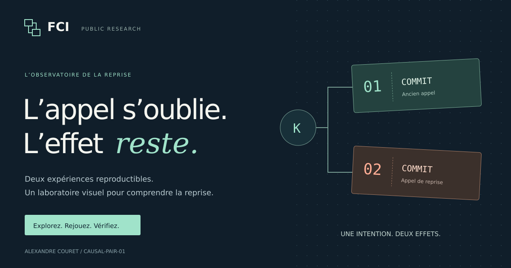

# Recovery after “not found”

## Native execution02 — explicit temporal capability

[New API and commands](native_execution_02/README.md) · [Received native evidence](native_execution_02/RECEPTION.md) · [Platform decision](native_execution_02/PLATFORM_DECISION.md).

SAMPLED_ADMISSION must be requested explicitly. COMMIT_DEADLINE is unavailable and refused before grant/DB/native entry, including cached-result paths. Signed version2 permits/RPCs and policy3 bind the declared capability. The new56-cell native campaign receives196 isolated capability refusals,12 sampled C effects and410 changed-evidence rejections per reader mode. Four late S-mode commits remain limit observations. C004 open / M1 HOLD / SR02 BLOCKED; this is research integration, not production migration. The prior packages below retain their historical scopes.


## Native C execution — received composition2, 12 November 2026

[Commands and sources](native_execution_01/README.md) · [Received evidence and limits](native_execution_01/RECEPTION.md) · [Public native CI](https://github.com/alexcour/CAUSAL-PAIR-01/actions/runs/43292958500).

All56 baseline cells pass and298 evidence mutations are rejected per reader mode. The lot includes12 C effects with durable permit consumption,4 lost-response result recoveries and4 verified FCI policy-abort receipts. A versioned composition places application SQL after all frozen native finalizers;37 native source files remain unchanged. Four deliberate late releases still COMMIT after deadline: this is a limit observation, not a physical COMMIT deadline guarantee. Trusted root/OS/owner, retained stores and no clones; M1 HOLD / SR02 BLOCKED. Earlier activation-only and failed execution lots remain documented below and in the receipt.


## Native activation01 — bounded public reception, 12 November 2026

[Source package and commands](native_activation_01/README.md) · [Received evidence and limits](native_activation_01/RECEPTION.md) · [Successful public CI](https://github.com/alexcour/CAUSAL-PAIR-01/actions/runs/43121546137).

Eight fresh native captures receive four C activations, eight signed native permits and four historical refusals. Expiry, revocation, component restart and dry authorization checks are received in the tested versioned routes. No C effect is executed. Permit consumption/revalidation at the actual native COMMIT, normal native service role C/rearm and arbitrary direct authorization submission remain unqualified. M1 HOLD / SR02 BLOCKED.

## Native admission01 — public standalone reproduction

[Source package and commands](native_admission_01/README.md) · [Public CI reception and preserved failures](native_admission_01/RECEPTION.md).

Eight fresh native cases receive four C admissions without execution and four historical refusals. The separately versioned offline receiver1.1 fixes a no-op mutation exposed by reversed client replies; the original71 sources remain preserved. This admission campaign precedes the separate activation study above. It does not itself activate or execute C; normal native-service restart and independent external validation remain open.

## Public bulletin — 10 November 2026

[Couret–Unification — Recherche ouverte](https://couret-recherche-publications.espace-de-tr-5012.chatgpt.site) · [Bulletin and English summary](docs/publication-20261110/bulletin.md) · [Announcement](docs/publication-20261110/COMMUNIQUE.md).

Updated 12 November: the bulletin distinguishes teaching models, historical admission results and the separate bounded public activation/permit reception. C execution is received in the bounded composition2 fixture campaign; physical COMMIT-deadline validity and production qualification remain open. Detailed historical private archives stay private; no independent validation is claimed. Mathematical research and MIRAGE have their own scopes.

## Identity and programme

FCI means **Formal Conservative Interposition**, a research and development programme on execution authorization and recovery after incidents.

**Alexandre Couret**  
**Président de la société CONFIANCE**  
**Porteur du programme FCI — Formal Conservative Interposition**

[Présentation FCI / English overview](docs/FCI_PRESENTATION_FR_EN.md) · [Author](https://www.couretunification.fr/a-propos/) · [HAL](https://cv.hal.science/alexandre-couret) · [Contact](https://www.couretunification.fr/contact/).

The experiments below are bounded public teaching models. Their guarantees and the status of the wider FCI programme are distinct.

[](https://fci-recovery-observatory.espace-de-tr-5012.chatgpt.site)

**Explore the interactive laboratory:** [English](https://fci-recovery-observatory.espace-de-tr-5012.chatgpt.site/?lang=en) · [Français](https://fci-recovery-observatory.espace-de-tr-5012.chatgpt.site)

Watch a duplicate commit, change the receiver contract, step through the recorded events, and remove a protection to expose its failure. The bilingual laboratory also compares recovery decisions after evidence loss. Each scenario links to its source trace and offers the raw JSON for inspection.

The animations replay the published synthetic records at commit `a374193`; they do not execute the experiments or evaluate the production FCI engine. Use the commands below to run the actual Python/HTTP/SQLite experiments.

Two reproducible experiments about external effects, missing evidence, and requests still in flight. Python standard library only, with SQLite databases and inspectable execution traces.

**The useful surprise:** receiver-side fencing can reject a late old request, yet still permit a duplicate when that old request committed just before the fence. A complete recovery contract must also account for prior commitment.

These are synthetic teaching models, not a new impossibility theorem or a benchmark of Temporal or production FCI. Standard receiver-side mechanisms succeed under the explicit assumptions tested here.

## Try the counterexample

```sh
git clone https://github.com/alexcour/CAUSAL-PAIR-01.git
cd CAUSAL-PAIR-01
python3 late_commit_02/experiment.py --out rerun_fence \
  --architecture receiver_fence_only --schedule old_first
```

Open `rerun_fence/receiver_fence_only__old_first/trace.json`. An old HTTP request arrives, an accurate lookup returns `NOT_FOUND`, the old request commits, recovery advances the receiver epoch, and the new request commits again. The final SQLite database contains **two effects for one business operation**.

Now replace `receiver_fence_only` with `fence_and_reconcile` and use a new output directory. That receiver atomically advances the epoch, reconciles prior commitment, and returns the existing result: **one effect** in this schedule.

## Chapter 1 — Lost evidence

[CAUSAL-PAIR-01](causal_pair_01/README.md) restores the receipt database while retaining the effects. One history has no initial effect; another has a committed effect. Both expose exactly the same evidence after restoration.

| Decision rule | No initial effect: final count | Initial effect committed: final count |
|---|---:|---:|
| Replay, including after checking the restored ledger | 1 | 2 |
| Conservative standard / identical minimal FCI-labelled rule | 0 | 1 |
| Positive control with additional authoritative evidence | 1 | 1 |

The conservative rules avoid duplication but leave the first history unfinished. They deliberately share the same implementation; the experiment demonstrates no FCI advantage. The positive control explicitly receives extra information.

Twenty executions across normal and optimized Python; sixty SQLite files checked by an internal read-only verifier. [Original archive](CAUSAL_PAIR_01_20261101.zip), [French report](causal_pair_01/report.html), [results](causal_pair_01/normal/results.json).

## Chapter 2 — A pending request after an accurate lookup

[LATE-COMMIT-02](late_commit_02/README.md) uses actual localhost HTTP requests, a threaded receiver, and SQLite transactions. The old request has already arrived when the recovery client's lookup reports `NOT_FOUND`.

Final effects for the same operation K:

| Receiver contract | Old commits first | Recovery completes first | No old request |
|---|---:|---:|---:|
| Check before call; no target protection | 2 | 2 | 1 |
| Receiver fencing only | 2 | 1 | 1 |
| Atomic idempotency | 1 | 1 | 1 |
| Atomic fencing + reconciliation | 1 | 1 | 1 |

**HTTP arrival, effect commitment, and a returned result are separate events.** The traces show each. Gates control the tested orders, so the example does not depend on getting lucky with timing.

Twenty-six executions across both Python modes produced matching traces and database outcomes. Six deliberate fault injections were detected: disabling the fence, disabling deduplication, and skipping prior-effect reconciliation, each under both modes. [Audit and matrix](late_commit_02/results/audit.json), [example failure trace](late_commit_02/results/normal/receiver_fence_only__old_first/trace.json), [mutation results](late_commit_02/results/mutations/summary.json).

The separate-fence design also has a third ordering: the old request reaches its transaction **after the fence but before the recovery effect**. In that case the old request is rejected and the total remains one effect. This additional case is included in the campaign, giving thirteen cases per Python mode.

## Reproduce the complete HTTP experiment

Python 3.11 or later; no third-party Python packages, credentials, or external services. The HTTP chapter needs permission to bind a localhost port.

```sh
python3 late_commit_02/experiment.py --out rerun_http/normal
python3 -O late_commit_02/experiment.py --out rerun_http/optimized
python3 late_commit_02/audit.py --root rerun_http
python3 late_commit_02/mutations.py --out rerun_mutations
python3 -m unittest discover -s late_commit_02/tests -v
python3 causal_pair_01/audit.py
```

Use fresh output directories. Checks stay active with `python -O`. The [CI workflow](.github/workflows/reproduce.yml) reruns both chapters and the fault injections on Python 3.11 and 3.13.

## Where the guarantees stop

The protected effects in Chapter 2 are SQL rows **inside the receiver transaction**. It does not model an independent payment, email, or physical action outside that transaction. Receiver state is retained throughout Chapter 2; Chapter 1 separately studies restored evidence. Combining those failure models requires another test.

There is no Temporal SDK integration, arbitrary-interleaving proof, storage power-loss qualification, performance benchmark, or production FCI evaluation. The read-only verifiers are internal checks, not external review. A bounded set of schedules and a progress control do not establish a universal exactly-once guarantee.

## Help make the contracts stronger

Can you produce a missing schedule, identify an unjustified assumption, or add a stronger conventional baseline? See [CONTRIBUTING.md](CONTRIBUTING.md). Please use synthetic data and include the exact command, trace, and committed effect count.

By Alexandre Couret. [Public discussion on the Temporal forum](https://community.temporal.io/t/recovery-after-an-idempotency-ledger-rollback-authoritative-evidence-and-replay-safety/19893/3).
